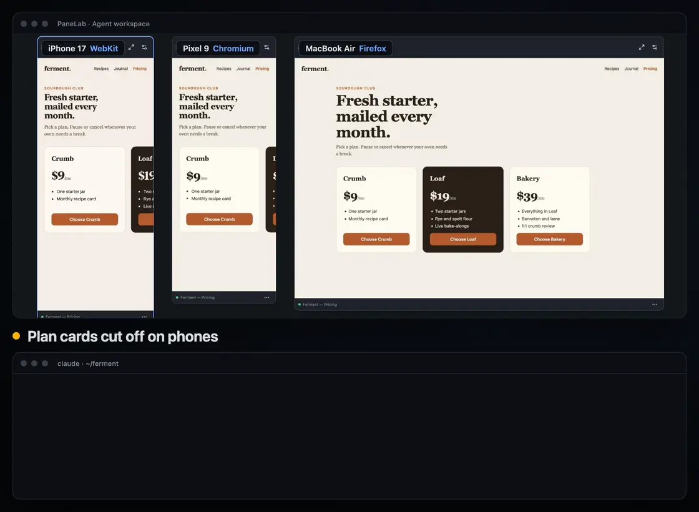

<div align="center">


# PaneLab

Catch responsive bugs across Chromium, WebKit, and Firefox.

[](https://github.com/moeen/panelab/actions/workflows/ci.yml)
[](https://github.com/moeen/panelab/releases)
[](LICENSE)


**[Download for Apple Silicon](https://github.com/moeen/panelab/releases/latest)** · [Quick start](#quick-start) · [Agent setup](#use-it-from-an-agent)<br />
Free and open source. macOS 15+. No account required.

<a href="docs/assets/demo.mp4"></a>

<sub>An agent finds an overflow bug through PaneLab's MCP server, fixes the CSS, and checks the fix. Click for the full-resolution video.</sub>

</div>

PaneLab is a macOS app for responsive web work. Open your localhost site at phone, tablet, and desktop sizes in one window, each preview running in a real browser engine. Compare layouts, inspect style differences, and check CSS fixes across previews. Use PaneLab directly or connect your coding agent through MCP.

<p align="center"></p>

## Features

- Every preview is a live Chromium, WebKit, or Firefox page with the device's viewport, pixel ratio, touch support, and user agent.
- Pick from 34 curated phones, tablets, and laptops, or define your own. Drag, resize, and arrange previews on a canvas, and zoom in on one.
- Mirror navigation, clicks, typing, and scrolling across previews when you want to, or keep each one independent.
- Sign in once. Previews in a workspace share cookies, localStorage, and IndexedDB across engines, saved encrypted with the macOS Keychain.
- Select an element once and compare its box and computed styles in every preview. Scan for overflow, engine differences, and mobile problems, then try CSS fixes live everywhere.
- Claude Code, Codex, Cursor, and other agents can open previews, take screenshots, scan, inspect, and diff through a CLI and an MCP server, with or without the app open.

## Install

### Download

1. Download `PaneLab-<version>-arm64.zip` from the [latest release](https://github.com/moeen/panelab/releases/latest) and unzip it.
2. Move `PaneLab.app` to `/Applications`.
3. The app isn't signed or notarized yet, so macOS blocks the first launch. Clear the quarantine flag once:

   ```sh
   xattr -dr com.apple.quarantine /Applications/PaneLab.app
   ```

After that, PaneLab updates itself from GitHub Releases and verifies each update's signature before installing it. Versions before 0.3.0 need one manual update.

To build it yourself, see [Run from source](#run-from-source).

## Quick start

1. On first launch, choose the browser engines to download. Chromium and WebKit are preselected, and nothing downloads until you confirm.
2. Start your dev server and type its address, like `localhost:3000`, into the address bar.
3. Pick devices in the sidebar. Each one opens as a live preview.
4. Select a preview and open the inspector, or run **Findings → Scan previews** to look for layout problems.

The [usage guide](docs/usage.md) covers the canvas, sync, inspector, sessions, shortcuts, and troubleshooting.

## Use it from an agent

Open **Settings → Agents and MCP** to install the `panelab` command and add PaneLab to your MCP clients. To watch the agent work in the app, also turn on **Let agents use this window**. It's off by default.

Then ask your agent something like:

> Use PaneLab to check localhost:3000 for mobile overflow. Inspect each finding, fix the CSS, and scan again to verify.

The same operations are available from the command line:

```sh
panelab scan localhost:3000 -d iphone-16@webkit -d macbook-air-13 -e webkit,chromium
panelab shot localhost:3000 -d iphone-16@webkit -d pixel-7 --out shots
panelab diff localhost:3000 -d macbook-air-13 --baseline .panelab/baseline
```

Without the app running, the CLI and MCP server run their own headless previews. With the app open and agent access on, agents work in a separate Agent workspace you can watch. See [agents, CLI, and MCP](docs/agents.md).

## Requirements

- macOS 15 or newer on Apple Silicon. Intel Macs and other systems aren't supported, and current WebKit builds no longer run on macOS 14.
- An internet connection for the first engine download. After that, PaneLab works offline with local sites and has no accounts or telemetry.

## FAQ

**Is this real Safari?** No. It runs WebKit, the engine behind Safari, but not the Safari app or the rest of iOS.

**Does it replace testing on real devices?** No. Emulation covers screen geometry and browser identity, not the whole operating system, so confirm hardware and OS-specific behavior on real devices.

**Do I need an AI agent?** No. Every feature works from the app. The CLI and MCP server are optional.

**Does it work offline?** Yes, with local sites, once the engines you chose have downloaded.

## Documentation

- [Usage guide](docs/usage.md)
- [Agents, CLI, and MCP](docs/agents.md)
- [Development](docs/development.md) and [testing](tests/README.md)
- [Security policy](SECURITY.md)

## Contributing

Bug reports and pull requests are welcome. Read [AGENTS.md](AGENTS.md) for the codebase rules and [docs/development.md](docs/development.md) for setup. Run `pnpm check`, `pnpm typecheck`, and the tests for the area you changed before opening a pull request.

### Run from source

You need Node.js 24 and pnpm 12.

```sh
git clone https://github.com/moeen/panelab.git
cd panelab
pnpm install --frozen-lockfile
pnpm dev
```

## License

[MIT](LICENSE)
